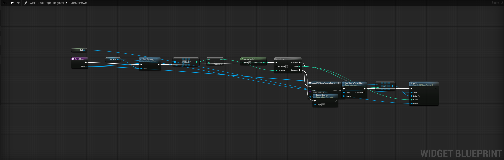
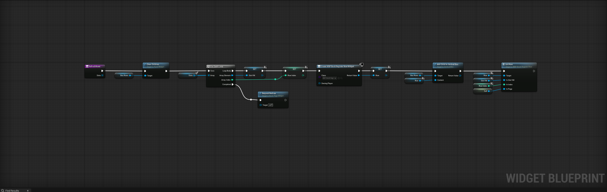

# ue-blueprint-layout

Readable Unreal Engine Blueprint graphs, built by Claude Code through the Unreal MCP server.

**Before:** the graph as an agent builds it with `write_graph_dsl`.



**After:** the same function, built with this skill and toolset.



Blueprint graphs that an agent builds with `write_graph_dsl` compile, but the nodes end up on
one row with long, crossing wires. This repository has two parts that fix that:

| Part | What it is |
|---|---|
| `unreal/BlueprintLayoutToolset` | Unreal Editor plugin. Adds an MCP toolset with the editor's own layout commands: Straighten Connection (Q), Align and Distribute, real node sizes, comment boxes, and deleting any node type. |
| `skill/ue-blueprint-layout` | Claude Code skill. Layout rules and a two-pass build: create the nodes, then lay them out with the toolset. |

## Layout rules

- One straight exec line. A loop body continues on it.
- A getter at each use of a function input, member variable or `self`, instead of long wires
  from Function Entry.
- Local variables for values that are used twice or far from their source, for example the
  Array Element and Array Index of a For Each loop.
- Getters for a node with several inputs are right-aligned and stacked. The top one is straight.
- Reroute nodes only where a wire would otherwise cross a node.
- A branch such as For Each Completed goes to a lower row. Its reroute is to the right of the
  source node, never to the left.

## Requirements

- Unreal Engine 5.8 with the experimental plugins **Model Context Protocol**, **Editor Toolset**
  and **Toolset Registry** enabled in the project. Toolset Registry is enabled by the plugin.
- A C++ project, or a Blueprint project that can build a C++ plugin (Visual Studio with the
  Unreal workloads).
- Claude Code connected to the Unreal MCP server.

## Install

Clone the repository, then:

```
python install.py skill
python install.py plugin "D:/Path/To/YourProject"
```

- `skill` copies the skill to `~/.claude/skills/ue-blueprint-layout`.
- `plugin` copies the plugin to `<project>/Plugins/BlueprintLayoutToolset`. Add `--gitignore`
  to keep the copy out of the project's repository.

Then close **every** Unreal Editor that uses the same engine, build the editor target, and start
the editor. Live Coding in any open editor on that engine blocks the build, even for another
project. Check the result in Claude Code: the MCP toolset list should contain
`BlueprintLayoutToolset.BlueprintLayoutToolset`.

To update, `git pull` and run the same commands again.

## Use

Ask Claude Code to create or tidy a Blueprint graph, for example:

> Clean up the layout of the RefreshRows function in WBP_BookPage_Register.

The skill loads automatically. The graph must be open in the Blueprint editor. The toolset
opens it when needed.

## Toolset reference

| Tool | Does |
|---|---|
| `StraightenConnection(SourceNode, SourcePin, NodeToMove, PinToAlign)` | Moves `NodeToMove` so the wire is straight, like pressing Q |
| `GetNodeBounds(Nodes)` | Position and drawn size of each node |
| `AlignNodes(Nodes, Alignment)` | Top, Middle, Bottom, Left, Center, Right, DistributeHorizontally, DistributeVertically |
| `AddCommentBox(Graph, Nodes, Text, Color, Padding)` | Comment box around the nodes |
| `SetNodePosition(Node, X, Y)` | Moves any node, comment boxes included |
| `DeleteNodes(Nodes)` | Deletes any node type, comment boxes included |

Straighten, Align and GetNodeBounds read the node widgets. Call them in a later tool call than
the one that created the nodes, so the editor has drawn them once.

## Tests

The plugin has automation tests for the parts that run without editor windows (comment boxes,
moving and deleting nodes):

```
UnrealEditor-Cmd.exe <Project>.uproject -ExecCmds="Automation RunTests BlueprintLayoutToolset" -TestExit="Automation Test Queue Empty" -nullrhi -unattended
```

## License

MIT. See [LICENSE](LICENSE).
